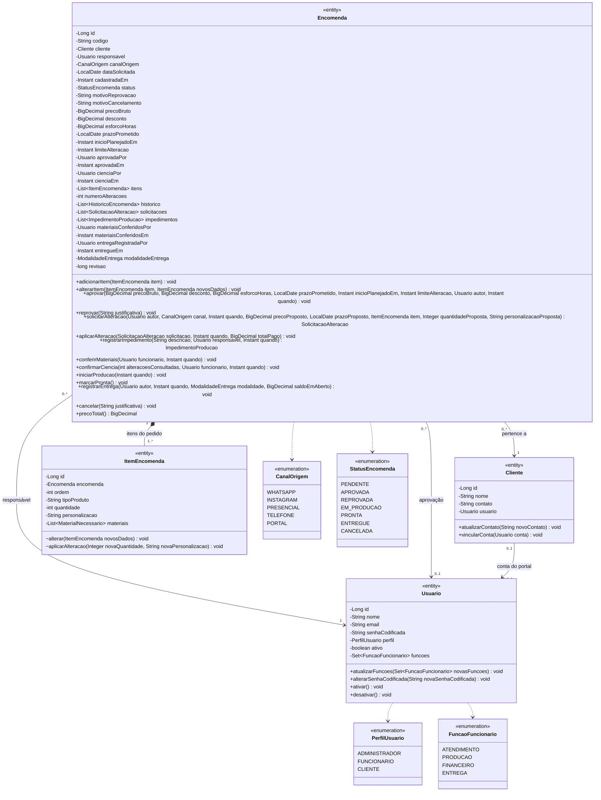
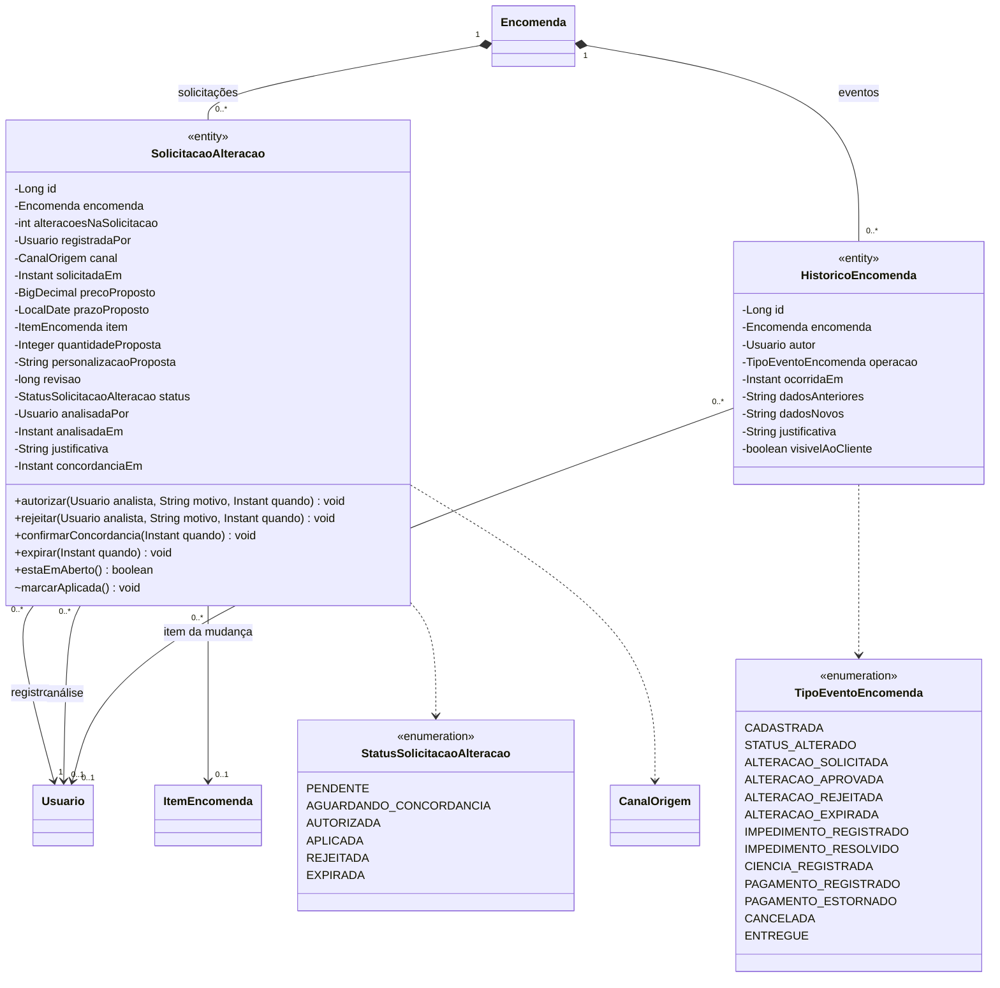
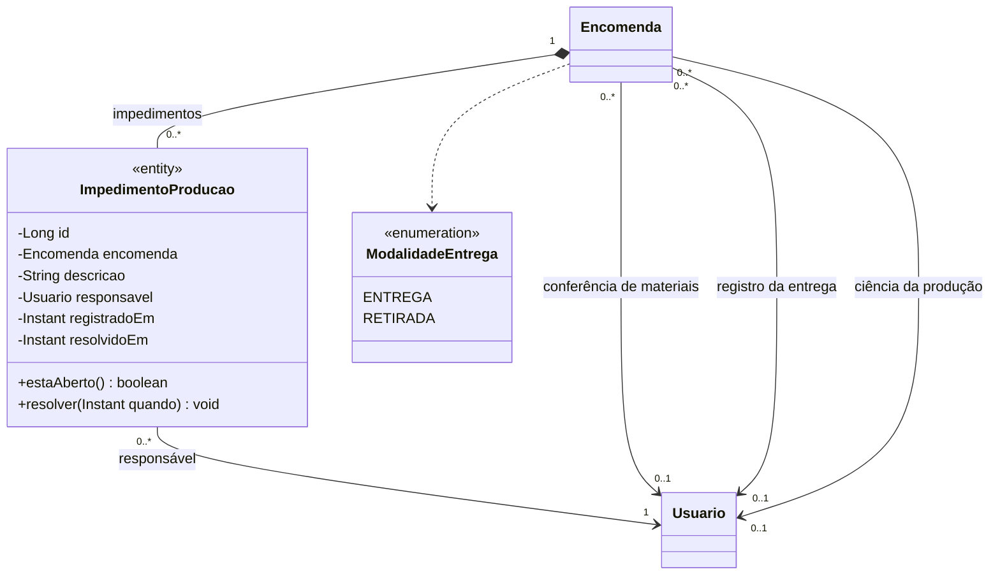
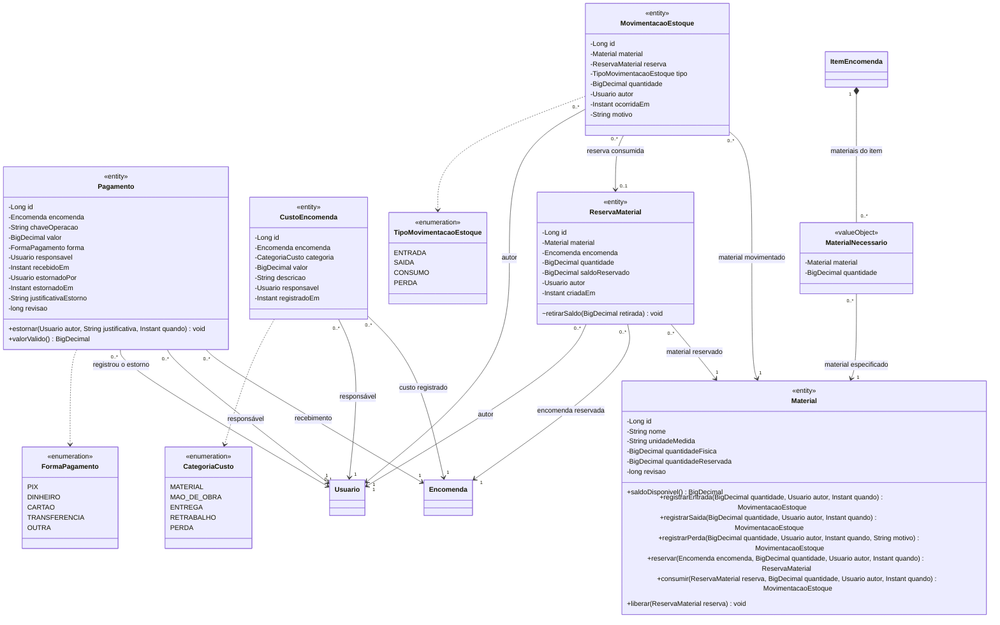

# Diagrama de classes do sistema de encomendas

O diagrama está organizado em quatro vistas. Cada classe tem uma vista com seus atributos e métodos de domínio. Nas outras vistas, ela pode aparecer somente pelo nome para mostrar seus relacionamentos.

## Cadastro e encomenda

## Alterações e histórico

## Produção e entrega

## Financeiro e estoque

## Decisões de modelagem

- A `Encomenda` guarda os itens, o preço e o prazo vigentes. A solicitação guarda somente o preço, o prazo ou a mudança de quantidade e personalização de um item existente.
- Aplicar uma solicitação autorizada atualiza a encomenda e registra os dados anteriores e novos no histórico. O contador de alterações identifica solicitações e confirmações desatualizadas.
- A encomenda guarda quem confirmou a ciência e quando, além da modalidade, do funcionário e da data da entrega.
- O cliente pode existir sem conta no portal. Os funcionários podem acumular funções operacionais. O histórico admite eventos automáticos sem autor humano.
- Cada pagamento admite um estorno integral, com responsável, data e justificativa no próprio pagamento. A disponibilidade de material deriva dos saldos físico e reservado.
- A lista de compras, os indicadores e o resultado estimado são consultas sobre os dados persistidos. Arquivos de arte ainda dependem de validação com o proprietário.
